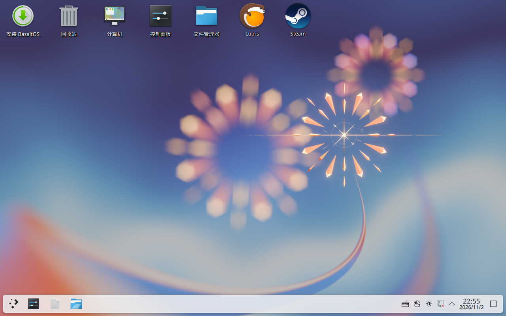
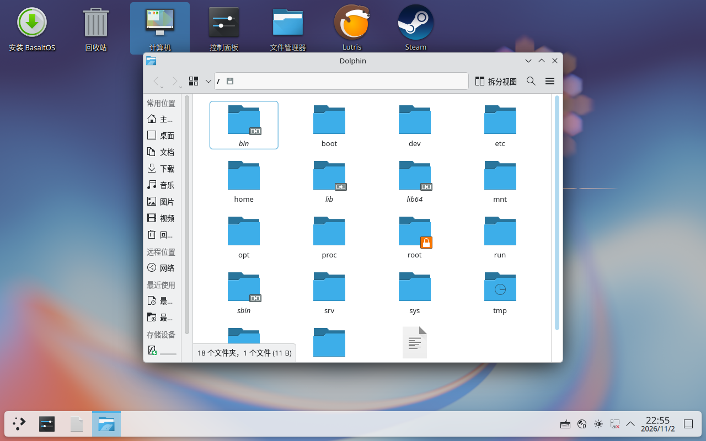

# BasaltOS 0.1.1 桌面入口修正验收

验收日期：2026-11-02，Asia/Shanghai。新 ISO 与既有 M6 测试系统的桌面入口修正均通过。
版本标签为 `v0.1.1`；首版 `v0.1.0`、原始附件和历史里程碑标签继续保留，不做 force-push。

- [下载 0.1.1](https://github.com/VyskoyeNebo/BasaltOS/releases/tag/v0.1.1)
- [0.1.1 发行说明](RELEASE-NOTES-0.1.1.md)
- [官网](https://vyskoyenebo.github.io/BasaltOS/)
- [首版 0.1.0](https://github.com/VyskoyeNebo/BasaltOS/releases/tag/v0.1.0)

## 公开发布结果

0.1.1 已于 2026-11-02 23:11（Asia/Shanghai）公开为 Latest Release，九个附件均上传完成。
服务端 SHA256 与本地全部相同；匿名 HEAD 检查九个下载地址均为 200，大小正确。
[官网部署 41469130129](https://github.com/VyskoyeNebo/BasaltOS/actions/runs/41469130129) 已成功，
匿名 HTTPS 检查 28 个页面/文件通过，公网签名仓库与本地验签后的文件逐字节一致。
首页下载按钮、完整 ISO SHA256 和实际桌面截图均已切换为 0.1.1。
[公网官网截图](0.1.1-site.jpg)另行保存。

发布前后比较已确认：`v0.1.0` 标签对象、发行说明及其九个附件的 ID、大小、SHA256、创建时间均未变。
新 `v0.1.1` 对应已验收源码提交 `65df65d`；本节的发布状态记录属于后续文档提交，版本标签保持不动。

## 原因与修正

Dolphin 与 KDE 系统设置原本已安装。首版仅预置安装器、Steam、Lutris 的桌面快捷方式，
没有为常用系统功能创建入口。

| 新入口 | 实际操作 |
| --- | --- |
| 计算机 | `dolphin --new-window /`，打开根文件系统；磁盘和可移动设备位于侧栏 |
| 回收站 | `dolphin --new-window trash:/` |
| 文件管理器 | `dolphin --new-window` |
| 控制面板 | `systemsettings`，打开 KDE 系统设置 |

四个文件位于 `/etc/skel/Desktop/basaltos-*.desktop`，archiso 明确赋予 755 权限。
新增的 `basaltos-desktop-shortcuts` 在 KDE 用户登录后补齐缺失入口，遵循 XDG 桌面目录，
不覆盖已有同名文件。新建入口后在当前用户会话运行 `kbuildsycoca6 --noincremental`。
用户主动删除的入口会在下次登录时补回；若不需要该行为，可禁用对应的 KDE 自动启动项。

**Plasma 6 首次点选可能需要确认信任。** 核对启动器来源与命令后再选择允许启动。
本次新 Live 和既有测试盘实际双击均直接打开；755 权限与应用缓存不替代系统的信任确认机制。

系统显示名及 `VERSION_ID` 更新为 0.1.1；自建 `basaltos-release` 元数据包为 0.1.1。
其余受保护的语言、时区、网络、输入法、加密、Snapper、GRUB、游戏和安全配置保持不变。

## 产物与签名

- ISO：`E:\BasaltOS\out\releases\0.1.1\basaltos-0.1.1-x86_64.iso`
- 原始构建输出：`E:\BasaltOS\out\desktop-fix\basaltos-2026.11.02-x86_64.iso`
- 大小：**2,353,299,456 bytes**，约 2.35 GB / 2.192 GiB。
- 卷标：`basaltos`，构建脚本直接检查 ISO9660 Primary Volume Descriptor。
- 构建工具：`archiso 92-1`，官方仓库继续使用清华镜像。

```text
ca16fc6de24984b2ef05f20b56175ce6b699b07302ab146c3e10668aa5028905
```

完整 ISO 大于 GitHub 单附件上限，Release 使用三个分片：

| 分片 | bytes | SHA256 |
| --- | ---: | --- |
| `basaltos-0.1.1-x86_64.iso.part00` | 1073741824 | `f27edd7cdca9697a1ecedc26270cd884de8bef9f239236c0095351c6ce412d66` |
| `basaltos-0.1.1-x86_64.iso.part01` | 1073741824 | `ee63e3d22e95e5b3a9f57d311476fb5534d874ece540b53e37ac6c4b26da4022` |
| `basaltos-0.1.1-x86_64.iso.part02` | 205815808 | `f92d844763fbb4b0b2d2827889524c63947a99aa5d2e3df69de91ef3252ac3ba` |

本地完整 ISO、分片、仓库归档和公钥均按新 `SHA256SUMS` 逐项验证；
签名清单、数据库及别名、两个软件包的 GPG 验证全部通过。
测试主钥指纹：`29DAFB5537B451968276DA003941AA503494B8B1`，到期 2027-05-01。
私钥保留在专用构建机工作盘，未导出到 Git、ISO、Pages 或附件。

## QEMU 验收与两张截图

从新 ISO 使用 UEFI + Windows WHPX 启动，登录 `gamer / basaltos`，进入 Plasma Wayland。
未向 Live 手工复制图标；四个入口均来自新镜像默认配置。

1. [四个入口齐全：0.1.1-desktop.png](0.1.1-desktop.png)
2. [实际双击计算机打开 Dolphin：0.1.1-computer.png](0.1.1-computer.png)





同时修正项目内既有 `work/m6/installed.qcow2`，登录用户 `basalt`。
[旧测试盘桌面](desktop-fix-installed-icons.png)与[旧测试盘 Dolphin](desktop-fix-installed-computer.png)另行保存。
其“控制面板”和“回收站”也已实际双击并打开对应界面。

新 Live 与旧测试盘均通过：`desktop-file-validate`、四个文件 755 权限、重复运行不覆盖、
hostname=basaltos、LANG=zh_CN.UTF-8、Asia/Shanghai、Fcitx5 进程及 nftables/NetworkManager active 检查。
新 Live 网络取得 `10.0.2.15/24`，HTTP 传输验证可用。
日志位于忽略目录 `work/desktop-fix/live-check.log` 与 `installed-check.log`。

Windows 从新 ISO 启动（首次创建独立空测试盘；文件存在时去掉 `-CreateDisk`）：

```powershell
Set-Location E:\BasaltOS
.\scripts\start-m6-qemu.ps1 -Boot live -Firmware uefi -Accelerator whpx `
  -Iso E:\BasaltOS\out\releases\0.1.1\basaltos-0.1.1-x86_64.iso `
  -Disk E:\BasaltOS\work\m6\desktop-fix-test.qcow2 -CreateDisk -QmpPort 4458
```

该脚本沿用 M6 的隔离磁盘范围。验收使用 `-Display none` 与 QMP screendump；
手动运行默认 SDL 窗口。WHPX 不可用时可改 `-Accelerator tcg`。

## 构建复现

沿用项目专属 VirtualBox 构建机，源码每次解包到新的 Linux ext4 目录，
调用 `scripts/build-desktop-fix-vm.sh`。脚本先运行 `check-desktop-fix.py`，
核对 106 个原配置文件/链接未变和唯一批准的 os-release 版本变更，
再执行桌面文件校验、严格签名仓库生成、mkarchiso、卷标/大小/SHA256 检查和签名导出。

宿主：

```powershell
python scripts/transfer-server.py
tar -cf work/desktop-fix-source.tar .gitattributes .gitignore profile scripts packaging docs README.md repo/README.md .github
```

专用构建机 Live root shell（已有项目系统及工作盘）：

```bash
curl -fsS http://10.0.2.2:8181/scripts/build-desktop-fix-vm.sh -o /tmp/build-desktop-fix.sh
bash /tmp/build-desktop-fix.sh
```

脚本在既有 `/mnt` 系统内通过 arch-chroot 构建，新增输出目录为
`work/m4-native/out-0.1.1-verified`、`repo-0.1.1-verified` 和 `release-0.1.1-verified`。
重新复现时应为已存在的签名输出选择新目录；release.sh 拒绝覆盖。
完整宿主构建日志：`work/desktop-fix/build-vm.log`。

## 问题与验证范围

- 专用工作盘初始仅余 3.9 GB，已从 64 GiB 扩为 128 GiB 并扩展原 ext4，保留旧构建。
  磁盘路径始终为本项目 `work/vms/BasaltOS-M1-builder/m4-work.vdi`。
- 初次桌面文件漏写默认语言 Comment，标准校验发现后已补齐，增加构建前校验并重新构建。
- 压缩期间虚拟键盘发生队列拥堵；改用 Guest Control 只读核对。压缩和最终导出均成功。
- Live 启动观察到一个 `systemd-loop@...block-sr0.service` 失败，针对光驱的附加 loop 单元。
  本次实际桌面、Dolphin、网络和输入法均可用；未对此启动单元做引导层修改。
- 本次没有重走完整 Calamares 安装或 BIOS 回归，历史 M3/M6 验收继续作为依据。
  Secure Boot、测试密钥、反作弊、虚拟 GPU 和明文 ESP/boot 限制见发行说明。

飞牛 OS 与 BasaltOS 的磁盘、虚拟机保持独立。本轮只操作 BasaltOS 项目内构建机和测试盘。
