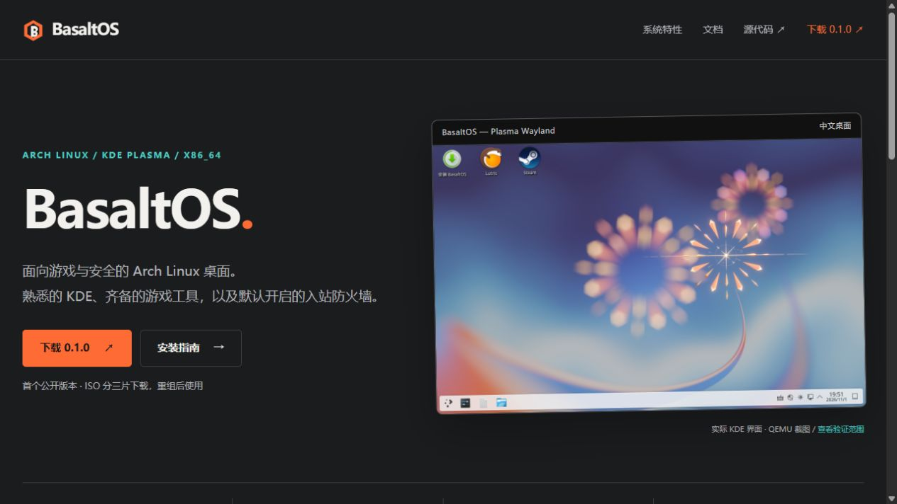

# M7 对外发布验收结果

验收日期：2026-11-02（Asia/Shanghai）。M7 已完成公开发布，未重建系统 ISO。
使用新建的个人公开仓库 `VyskoyeNebo/BasaltOS`；没有使用组织或修改其他仓库。

## 公开入口

| 项目 | 地址与状态 |
| --- | --- |
| 代码仓库 | [VyskoyeNebo/BasaltOS](https://github.com/VyskoyeNebo/BasaltOS)，public，main 已推送 |
| 官网 | [BasaltOS](https://vyskoyenebo.github.io/BasaltOS/)，HTTPS 200，Actions 部署成功 |
| 文档站 | [快速开始](https://vyskoyenebo.github.io/BasaltOS/docs/QUICKSTART.html)，含构建、游戏、安全、隐私、Secure Boot、发布与 M1–M7 记录 |
| 正式 Release 页面 | [BasaltOS 0.1.0](https://github.com/VyskoyeNebo/BasaltOS/releases/tag/v0.1.0)，公开、非草稿、Latest；系统成熟度仍为实验阶段 |
| 签名软件仓库 | `https://vyskoyenebo.github.io/BasaltOS/x86_64`，数据库、包及签名已部署；ISO 默认关闭，需明确启用 |
| 首轮成功部署 | [Actions run 41459983538](https://github.com/VyskoyeNebo/BasaltOS/actions/runs/41459983538)，prepare / deploy 均 success |

M2–M6 标签及 `0.1.0-m6` 已全部推送；新增 `v0.1.0` 指向已验收的 M6 提交
`c014311eaeecb77c4fabf5591e60a4f79cf39f17`。M7 源码、官网和验收记录由 `m7-site` 标记。
历史 `gh-pages` 分支已推送留档，当前 Pages 来源是 main 的 GitHub Actions。

## ISO 与附件

本地完整 ISO：`E:\BasaltOS\out\releases\0.1.0-m6\basaltos-0.1.0-m6-x86_64.iso`。
大小 **2,353,299,456 bytes**，约 **2.35 GB / 2.192 GiB**。

```text
0fd12156f204a6b6535c19aca1ae0f229e8e8b02579772602e68530034a27281
```

GitHub 单附件限制小于 2 GiB，因此完整 ISO 通过三个分片发布。
分片、仓库归档和清单保留原 M6 文件名，维护现有签名的有效性。
九个用户附件均上传完成，GitHub 返回的 SHA256、大小与本地文件全部一致；
匿名 HEAD 请求九个下载地址均返回 200，Content-Length 全部正确。
没有从公网重新下载整个 2.35 GB 镜像；内容核对使用 GitHub 的服务端散列及本地既有完整散列。

| 附件 | bytes | SHA256 |
| --- | ---: | --- |
| `basaltos-0.1.0-m6-x86_64.iso.part00` | 1073741824 | `432f3eb30d0fe7ff02601d8a5ef8a22fbf0f32a8ec86f05c13430edd538a17e2` |
| `basaltos-0.1.0-m6-x86_64.iso.part01` | 1073741824 | `b875b5d139cf09fe568041905db2b3e640e137ac86da1dc1816f71630c009133` |
| `basaltos-0.1.0-m6-x86_64.iso.part02` | 205815808 | `b2b56bd0b00193ca7976cfac348ea8ac311387dc7edcd832de9689e0fd5b8f01` |
| `basaltos-0.1.0-m6-x86_64.iso.sha256` | 96 | `dcb2001029f74ffe5f2b9d16726e0d34d27961e8604c221c5352bdb3259afd88` |
| `basaltos-key.asc` | 843 | `67f4bf656cf6cd691393017647181af29470f336ca56770381ff5ed1d5acb695` |
| `join-iso.py` | 2145 | `10f66bd2bfae1828c1a7966c5120a0e54f488182fa8a77dd3c560bf18359cfd7` |
| `pacman-repo-0.1.0-m6.tar.gz` | 4790744 | `d6d39f33f8c8bed90f1e8fb736711557fde9ba25a6decc56469a94846101eabf` |
| `SHA256SUMS` | 578 | `a6a4b1053f13c3ed6d2b3973e2428648831da17b71ae7d7eb802a0163fd5d5ce` |
| `SHA256SUMS.asc` | 228 | `2970b4ff21bdb00415493ceedf440e1709da71c33c967d539ba22908bf5c89a8` |

公钥主指纹：`29DAFB5537B451968276DA003941AA503494B8B1`。
这是 **TEST Release 测试身份**，有效至 2027-05-01，正式离线密钥管理尚未部署。
ISO/分片散列由原签名清单认证；新增独立 `.sha256` 和便捷 `join-iso.py` 不属于原 M6 签名清单。
下载与重组命令见[快速开始](QUICKSTART.md)。

## 验证证据

- 匿名浏览器确认仓库为 Public、main 代码可见、README 快速开始渲染正常，历史标签齐全。
- 官网采用 `#1B1C1E` / `#FF6B35` / `#4ECDC4`，使用系统字体、本地 SVG 和真实 KDE 截图；无外部字体、图片或统计脚本。
- 本地与 Ubuntu Actions 都通过 GPG 清单、仓库归档、数据库别名及两个软件包签名验证。
  Actions 日志有七次 `Good signature`，固定主指纹检查通过。
- 合并站点生成 22 份 Markdown 文档、首页及 404；24 个 HTML 的内部链接、锚点和本地资源检查通过。
- 本地浏览器验证桌面与 390×844 手机文档布局、移动目录展开及搜索；公网验证首页、文档入口和搜索。
- 通过匿名 HTTPS 检查 26 个页面/文件。公网所有仓库文件与本地验签后版本逐字节相同，公钥和签名清单也相同。
- `python scripts/check-m6-source.py` 通过：107 个 M5 受保护文件/链接、更新/恢复逻辑、默认禁用占位仓库及私钥/大文件排除检查均通过。
  M7 与 `0.1.0-m6` 的 profile、packaging、ISO 发布脚本、重组及原验签脚本没有差异。
- 推送前扫描 326 个历史 Git blob，未检出令牌或私钥 armor；最大历史 blob 为约 606 KB 的截图。
  `out/`、`work/`、ISO/分片、构建日志和私钥不在 Git。

公网首页截图：[m7-site.jpg](m7-site.jpg)。



本地原始检查记录保存在忽略目录 `work/m7/`：
`release-assets-verified.json`、`release-public-verified.json`、`pages-http-verified.json`。
工作流和站点复现方式见[公开发版维护](PUBLISHING.md)。

## 问题与已知限制

1. ISO 超过 GitHub 单附件上限，已通过三分片解决；用户需要重组后写盘。
2. Windows Git 自带的 MSYS GPG 不接受原验证器传入的 Windows 绝对路径。
   本地用 `work/m7/verify-msys-gpg.py` 仅转换进程参数路径完成验证，未修改 M6 验证器。
   线上 Ubuntu 流程直接运行原脚本并验签成功。
3. Actions 有上游 Node.js 20 迁移提示，平台使用 Node.js 24 运行；本次构建和部署成功。
4. Secure Boot 未启用；反作弊支持逐游戏而异，虚拟 GPU 验证不代表物理显卡性能。
   M3 曾验证 BIOS/UEFI，M5/M6 重验的是 UEFI；M7 未增加虚拟机、实体硬件或 USB 兼容测试。
5. LUKS 不覆盖明文 ESP 与独立 `/boot`；快照恢复仍需按安全文档操作。
   测试签名身份、默认关闭的测试仓库和历史 M3/M4 品牌文字继续保留。
   完整范围见[0.1.0 发行说明](RELEASE-NOTES-0.1.0.md)。

本轮仅完成 M7，系统 payload 保持 M6 已验收版本，未操作其他项目或虚拟机。
